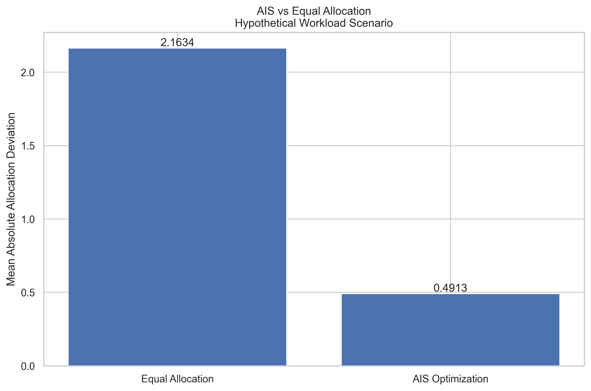
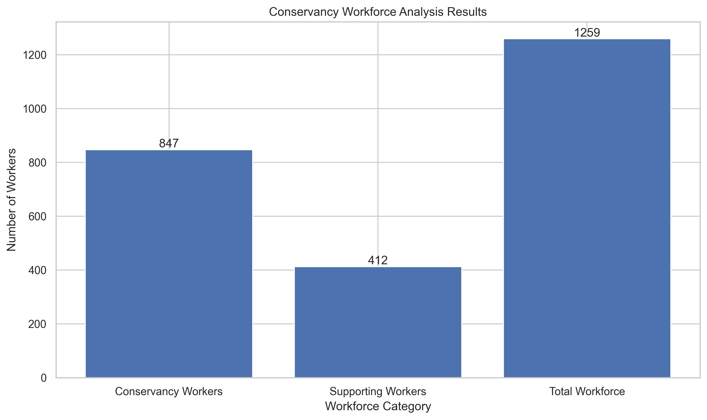
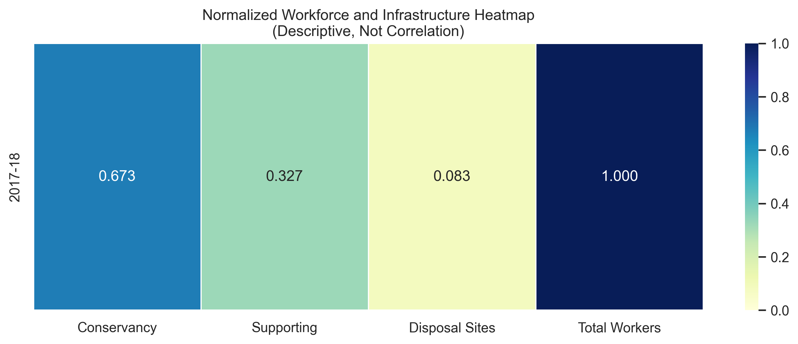
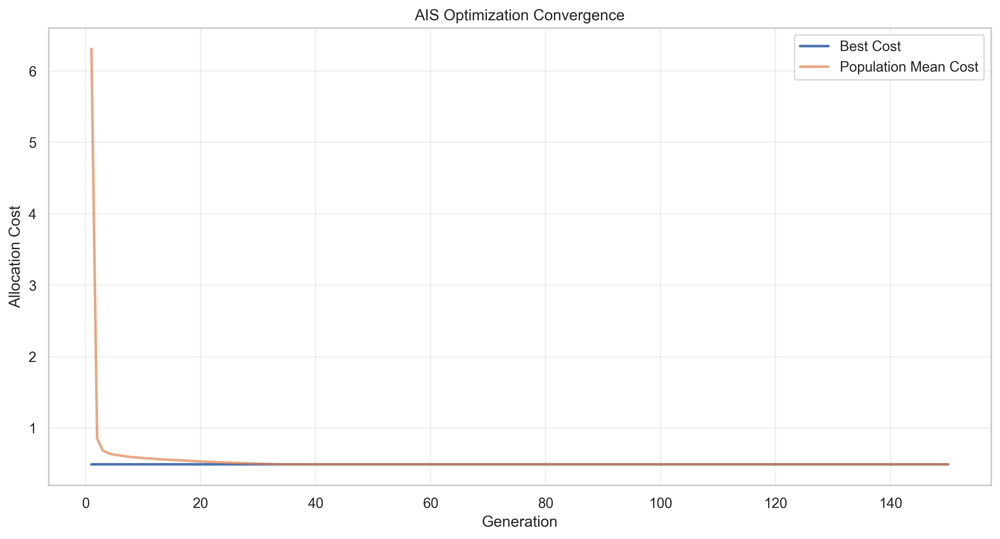
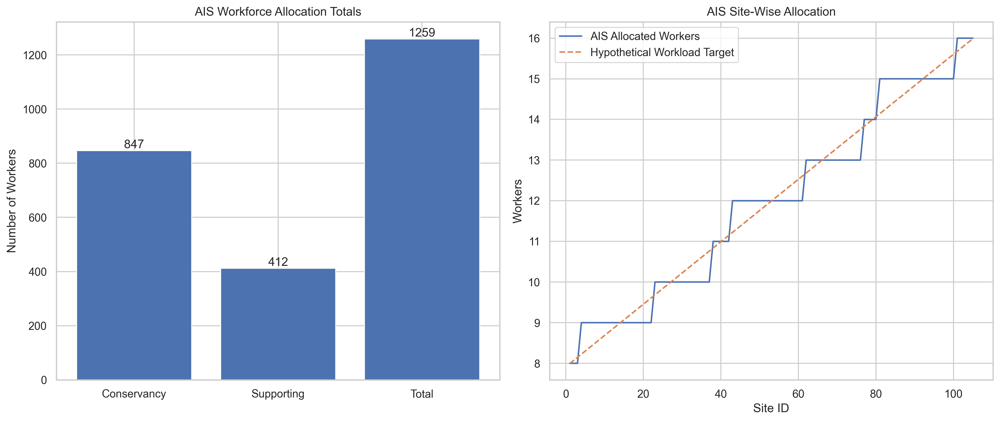
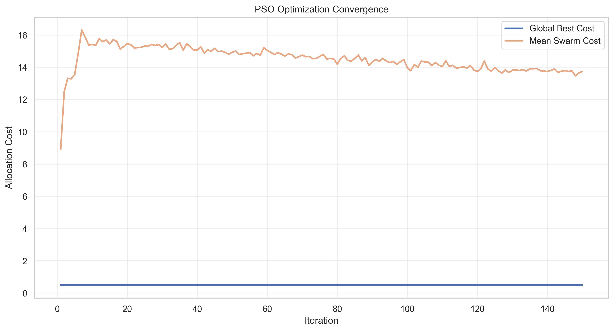
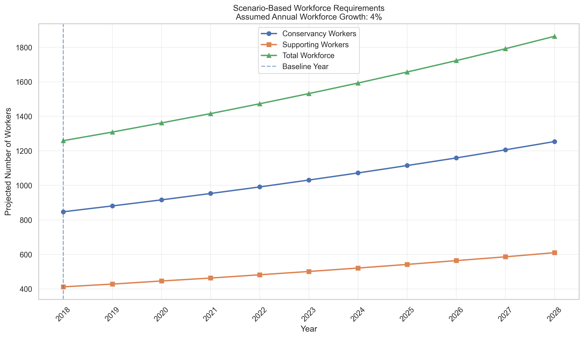

# AI-Based Conservancy Workforce Analysis, Waste Disposal Infrastructure Assessment, and Resource Optimization System

## 📌 Project Overview

The **AI-Based Conservancy Workforce Analysis, Waste Disposal Infrastructure Assessment, and Resource Optimization System** is a data-driven research project designed to analyze municipal conservancy workforce distribution, assess waste disposal infrastructure, and investigate intelligent resource allocation using optimization algorithms.

The project uses a government statistical dataset from **2017–18** containing information about conservancy workers, garbage and sewage disposal sites, and personnel engaged in supporting conservancy activities.

The system implements three resource allocation approaches:

1. **Baseline Mathematical Allocation**
2. **Artificial Immune System (AIS) — Clonal Selection Algorithm**
3. **Particle Swarm Optimization (PSO)**

The project also includes descriptive statistical analysis, workforce visualization, scenario-based forecasting, optimization convergence analysis, and comparative algorithm evaluation.

> **Research Note:** The available dataset contains one aggregate observation. Therefore, the project focuses on descriptive analytics and mathematical optimization under explicitly defined workload assumptions. The generated forecasts are scenario-based projections rather than independently validated machine learning predictions.

---

## 🎯 Project Objectives

The primary objectives of this project are:

- Analyze conservancy workforce availability and distribution.
- Assess garbage and sewage disposal infrastructure.
- Calculate workforce-to-disposal-site ratios.
- Develop mathematical workforce allocation models.
- Implement AIS-based workforce optimization.
- Implement PSO-based workforce optimization.
- Compare optimization algorithms using a common objective function.
- Generate scenario-based future workforce requirements.
- Visualize allocation patterns and algorithm convergence.
- Export results into CSV, PNG, PKL, H5, YAML, and JSON formats.
- Support data-driven municipal resource planning.

---

## 📊 Dataset Description

### Dataset Name

**Number of Conservancy Workers Engaged in Conservancy, Garbage and Debris Disposal and Other Particulars (2017–18)**

### Dataset File

```text
number_of conservancy_workers_engaged_in_conservancy_garbage_and_debris_disposal_and_other_particulars_2017_18.csv
```

### Dataset Characteristics

| Attribute | Description |
|-----------|-------------|
| Dataset Type | Government statistical data |
| Reference Period | 2017–18 |
| File Format | CSV |
| Observations | 1 |
| Original Columns | 4 |
| Analysis Type | Descriptive and optimization-based |
| Domain | Municipal Waste Management |
| Application | Workforce and Infrastructure Planning |

### Dataset Attributes

| Attribute | Description |
|-----------|-------------|
| Conservancy Workers | Number of personnel engaged in conservancy operations |
| Disposal Sites | Number of garbage and sewage disposal sites |
| Supporting Workers | Personnel engaged in other connected conservancy activities |

### Dataset Statistics

| Parameter | Value |
|-----------|-------|
| Conservancy Workers | 847 |
| Supporting Workers | 412 |
| Total Workforce | 1,259 |
| Garbage and Sewage Disposal Sites | 105 |
| Average Conservancy Workers per Site | 8.07 |
| Average Supporting Workers per Site | 3.92 |
| Average Total Workers per Site | 11.99 |

These ratios describe aggregate workforce availability. They do not establish actual staffing levels at individual disposal sites.

---

## 🏗️ System Architecture

The proposed system follows a modular processing architecture.

```text
                  +-----------------------+
                  | Government CSV Dataset|
                  +-----------+-----------+
                              |
                              v
                  +-----------------------+
                  | Data Loading and      |
                  | Validation            |
                  +-----------+-----------+
                              |
                              v
                  +-----------------------+
                  | Data Preprocessing    |
                  | and Feature Engineering|
                  +-----------+-----------+
                              |
                              v
                  +-----------------------+
                  | Workforce and         |
                  | Infrastructure Analysis|
                  +-----------+-----------+
                              |
               +--------------+--------------+
               |              |              |
               v              v              v
       +---------------+ +-------------+ +-------------+
       | Mathematical  | | AIS         | | PSO         |
       | Allocation    | | Optimization| | Optimization|
       +-------+-------+ +------+------+ +------+------+
               |                |               |
               +----------------+---------------+
                                |
                                v
                    +-----------------------+
                    | Performance Comparison|
                    | and Convergence       |
                    +-----------+-----------+
                                |
                                v
                    +-----------------------+
                    | Scenario-Based        |
                    | Workforce Projections |
                    +-----------+-----------+
                                |
                                v
                    +-----------------------+
                    | Visualization and     |
                    | Result Generation     |
                    +-----------+-----------+
                                |
                                v
                    +-----------------------+
                    | CSV / PNG / PKL / H5  |
                    | YAML / JSON Outputs   |
                    +-----------------------+
```

---

## 🧠 Algorithms Implemented

### 1. Baseline Mathematical Workforce Allocation

The baseline approach distributes available workers approximately equally across disposal sites.

Let:

- C = Total conservancy workers
- S = Total supporting workers
- N = Number of disposal sites

The average conservancy workers per site is:

\[
C_{\text{avg}} = \frac{C}{N}
\]

The average supporting workers per site is:

\[
S_{\text{avg}} = \frac{S}{N}
\]

The average total workforce per site is:

\[
W_{\text{avg}} = \frac{C+S}{N}
\]

Integer allocation is performed using quotient and remainder distribution.

This ensures that:

- Every worker is allocated.
- Worker counts remain nonnegative integers.
- Total workforce is preserved.
- Allocations are approximately balanced.

The baseline serves as a reference for evaluating optimization algorithms.

---

### 2. Artificial Immune System (AIS)

The Artificial Immune System is a bio-inspired optimization technique based on the adaptive immune response.

This project implements the **Clonal Selection Algorithm (CLONALG)**.

#### AIS Optimization Procedure

1. Initialize a population of feasible workforce allocations.
2. Evaluate the fitness of each candidate.
3. Select high-fitness candidates.
4. Clone selected candidates.
5. Apply somatic hypermutation.
6. Evaluate mutated candidates.
7. Preserve the best solution through immune memory.
8. Repeat until the maximum number of generations is reached.

#### AIS Configuration

| Parameter | Value |
|-----------|-------|
| Algorithm | Clonal Selection |
| Population Size | 35 |
| Generations | 150 |
| Elite Antibodies | 8 |
| Clones per Elite | 5 |
| Random Immigrants | 5 |
| Random Seed | 42 |

#### AIS Advantages

- Supports discrete workforce allocation.
- Preserves feasible solutions during mutation.
- Maintains high-quality solutions using immune memory.
- Explores alternative resource distributions.
- Provides optimization convergence history.

---

### 3. Particle Swarm Optimization (PSO)

Particle Swarm Optimization is a population-based metaheuristic inspired by collective swarm behavior.

Each particle represents a candidate workforce allocation.

Particles update their positions using their personal best solution and the globally best solution.

#### Velocity Update Equation

\[
v_i^{t+1} =
\omega v_i^t +
c_1r_1(pbest_i-x_i^t) +
c_2r_2(gbest-x_i^t)
\]

Where:

- \(v_i\) = Particle velocity
- \(x_i\) = Particle position
- \(\omega\) = Inertia weight
- \(c_1\) = Cognitive coefficient
- \(c_2\) = Social coefficient
- \(r_1,r_2\) = Random values
- \(pbest\) = Personal best position
- \(gbest\) = Global best position

#### Position Update Equation

\[
x_i^{t+1}=x_i^t+v_i^{t+1}
\]

Continuous particle positions are decoded into feasible integer workforce allocations.

#### PSO Configuration

| Parameter | Value |
|-----------|-------|
| Swarm Size | 40 |
| Maximum Iterations | 150 |
| Initial Inertia | 0.9 |
| Final Inertia | 0.4 |
| Cognitive Coefficient | 1.8 |
| Social Coefficient | 1.8 |
| Velocity Limit | 3.0 |
| Random Seed | 42 |

#### PSO Advantages

- Searches a multidimensional allocation space.
- Maintains personal and global best solutions.
- Supports convergence analysis.
- Produces feasible integer allocations through decoding.
- Can be compared with AIS using the same objective.

---

## ⚙️ Optimization Objective Function

Both AIS and PSO minimize deviation from hypothetical workload-weighted staffing targets.

The optimization objective is:

\[
J =
\frac{1}{N}
\sum_{i=1}^{N}
|C_i-C_i^*|
+
\frac{1}{N}
\sum_{i=1}^{N}
|S_i-S_i^*|
\]

Where:

- \(N\) = Number of disposal sites
- \(C_i\) = Allocated conservancy workers at site i
- \(S_i\) = Allocated supporting workers at site i
- \(C_i^*\) = Target conservancy allocation
- \(S_i^*\) = Target supporting allocation

The fitness function is:

\[
F=\frac{1}{1+J}
\]

### Optimization Interpretation

| Metric | Interpretation |
|--------|----------------|
| Allocation Cost | Lower is better |
| Optimization Fitness | Higher is better |
| Convergence | Change in objective value over iterations |
| Workforce Conservation | Allocated workers equal available workers |
| Feasibility | Nonnegative integer allocations |

**Important:** Optimization fitness is not equivalent to machine learning prediction accuracy.

---

## 📈 Visualization and Results

### AIS Optimization Comparison

The following graph compares AIS optimization against equal workforce allocation under the assumed workload scenario.



**Figure 1: AIS vs. Equal Workforce Allocation**

The graph displays the allocation cost for the two approaches.

A lower allocation cost indicates that the allocation is closer to the hypothetical workload-weighted staffing targets.

This comparison evaluates performance under the selected mathematical objective. It does not demonstrate measured improvements in actual municipal operations.

### Other Generated Visualizations

#### Workforce Distribution



Displays the observed conservancy workforce, supporting workforce, and total workforce.

#### Workforce and Infrastructure Heatmap



Shows normalized workforce and infrastructure statistics.

#### AIS Convergence



Shows the change in AIS allocation cost across generations.

#### AIS Workforce Allocation



Visualizes the site-wise workforce distribution generated by AIS.

#### PSO Convergence



Shows PSO global-best and mean-swarm allocation costs across iterations.

#### PSO Comparison


Compares PSO allocation cost with the equal-distribution baseline.

#### PSO Workforce Allocation


Displays PSO-generated workforce allocations.

#### Scenario-Based Workforce Projection



Displays projected workforce requirements under assumed annual growth rates.

---

## 🔮 Workforce Requirement Projections

The project includes scenario-based workforce projections using compound growth assumptions.

### Workforce Projection Formula

\[
W_t=W_0(1+r)^t
\]

Where:

- \(W_t\) = Projected workforce at year t
- \(W_0\) = Baseline workforce
- \(r\) = Assumed annual growth rate
- \(t\) = Number of years after the baseline

### Disposal Infrastructure Projection

\[
D_t=D_0(1+g)^t
\]

Where:

- \(D_t\) = Projected disposal sites
- \(D_0\) = Baseline disposal sites
- \(g\) = Assumed annual site growth rate

### Scenario Parameters

| Parameter | Value |
|-----------|-------|
| Baseline Year | 2018 |
| Projection Horizon | 10 Years |
| Workforce Growth Rate | 4% Annually |
| Disposal Site Growth Rate | 3% Annually |
| Projection Method | Compound Growth Scenario |

The resulting workforce requirements are passed to AIS and PSO for scenario-based allocation optimization.

These growth rates are illustrative assumptions, not estimates learned from the dataset.

---

## 🛠️ Technologies Used

| Category | Technology |
|----------|------------|
| Programming Language | Python |
| Data Processing | Pandas |
| Numerical Computing | NumPy |
| Visualization | Matplotlib |
| Statistical Visualization | Seaborn |
| Optimization | AIS, PSO |
| Model Serialization | Pickle |
| HDF5 Storage | h5py |
| Configuration Management | PyYAML |
| Metadata Storage | JSON |
| Development Environment | Jupyter Notebook / VS Code |

---

## 📁 Project Directory Structure

```text
AI-Based Conservancy Workforce Analysis/
│
├── number_of conservancy_workers_engaged_in_conservancy_garbage_and_debris_disposal_and_other_particulars_2017_18.csv
│
├── README.md
│
├── conservancy_workforce_model.h5
├── conservancy_workforce_model.pkl
├── model_config.yaml
├── project_metadata.json
│
├── accuracy_graph.png
├── heatmap.png
├── comparison_graph.png
├── result.csv
├── result_graph.png
├── prediction.csv
├── prediction_graph.png
├── resource_allocation.csv
├── allocation_comparison.csv
├── site_allocation_graph.png
│
├── ais_accuracy_graph.png
├── ais_heatmap.png
├── ais_comparison_graph.png
├── ais_result.csv
├── ais_result_graph.png
├── ais_prediction.csv
├── ais_prediction_graph.png
├── ais_resource_allocation.csv
├── ais_comparison.csv
├── ais_convergence.csv
├── ais_convergence_graph.png
├── ais_model.pkl
├── ais_model.h5
├── ais_model_config.yaml
├── ais_project_metadata.json
│
├── pso_accuracy_graph.png
├── pso_heatmap.png
├── pso_comparison_graph.png
├── pso_result.csv
├── pso_result_graph.png
├── pso_prediction.csv
├── pso_prediction_graph.png
├── pso_resource_allocation.csv
├── pso_comparison.csv
├── pso_convergence.csv
├── pso_convergence_graph.png
├── pso_model.pkl
├── pso_model.h5
├── pso_model_config.yaml
│
└── pso_project_metadata.json
```

All files are generated by the corresponding Python implementations. The source scripts or notebooks should also be included when publishing the repository.

---

## 🚀 Installation and Setup

### Prerequisites

- Python 3.10 or later
- pip package manager
- Jupyter Notebook or VS Code
- Original CSV dataset

### Step 1: Clone the Repository

```bash
git clone https://github.com/YOUR_USERNAME/YOUR_REPOSITORY.git
```

Replace the placeholder URL with the actual GitHub repository address.

### Step 2: Navigate to the Project Directory

```bash
cd YOUR_REPOSITORY
```

### Step 3: Install Dependencies

```bash
pip install numpy pandas matplotlib seaborn scikit-learn h5py pyyaml
```

### Step 4: Configure Dataset Path

Update the `BASE_DIR` variable in the Python implementations.

```python
from pathlib import Path

BASE_DIR = Path(
    r"C:\Users\sagni\Downloads\AI-Based Conservancy Workforce Analysis, Waste Disposal Infrastructure Assessment, and Resource Optimization System"
)
```

The CSV file must be present in the specified directory.

### Step 5: Execute the Implementations

Run the implementations in the following order:

1. Baseline workforce analysis
2. AIS optimization
3. PSO optimization

The code can be executed using Jupyter Notebook or VS Code.

Each implementation automatically generates its corresponding results and visualizations.

---

## 📂 Output File Descriptions

### Baseline Analysis Outputs

| File | Description |
|------|-------------|
| `result.csv` | Descriptive workforce statistics |
| `prediction.csv` | Scenario-based workforce estimates |
| `resource_allocation.csv` | Equal-distribution allocation |
| `heatmap.png` | Descriptive workforce heatmap |
| `comparison_graph.png` | Mathematical allocation comparison |
| `accuracy_graph.png` | Prediction evaluation availability |
| `conservancy_workforce_model.pkl` | Serialized allocation model |
| `conservancy_workforce_model.h5` | HDF5 data and results |

### AIS Outputs

| File | Description |
|------|-------------|
| `ais_result.csv` | AIS optimization summary |
| `ais_prediction.csv` | AIS scenario projections |
| `ais_resource_allocation.csv` | AIS site-wise allocations |
| `ais_comparison.csv` | AIS vs. equal allocation metrics |
| `ais_convergence.csv` | AIS optimization history |
| `ais_accuracy_graph.png` | AIS fitness visualization |
| `ais_heatmap.png` | AIS allocation heatmap |
| `ais_comparison_graph.png` | AIS comparison visualization |
| `ais_model.pkl` | Saved AIS solution |
| `ais_model.h5` | AIS HDF5 results |
| `ais_model_config.yaml` | AIS configuration |
| `ais_project_metadata.json` | AIS metadata |

### PSO Outputs

| File | Description |
|------|-------------|
| `pso_result.csv` | PSO optimization summary |
| `pso_prediction.csv` | PSO scenario projections |
| `pso_resource_allocation.csv` | PSO site-wise allocations |
| `pso_comparison.csv` | PSO vs. equal allocation metrics |
| `pso_convergence.csv` | PSO optimization history |
| `pso_accuracy_graph.png` | PSO fitness visualization |
| `pso_heatmap.png` | PSO allocation heatmap |
| `pso_comparison_graph.png` | PSO comparison visualization |
| `pso_model.pkl` | Saved PSO solution |
| `pso_model.h5` | PSO HDF5 results |
| `pso_model_config.yaml` | PSO configuration |
| `pso_project_metadata.json` | PSO metadata |

---

## 📊 Algorithm Comparison

The three implemented approaches can be evaluated using a shared mathematical objective.

| Feature | Baseline | AIS | PSO |
|---------|----------|-----|-----|
| Resource Allocation | Yes | Yes | Yes |
| Population-Based Optimization | No | Yes | Yes |
| Iterative Search | No | Yes | Yes |
| Optimization Fitness | Calculable | Yes | Yes |
| Convergence Analysis | No | Yes | Yes |
| Integer Allocation | Yes | Yes | Yes |
| Workforce Conservation | Yes | Yes | Yes |
| Scenario-Based Planning | Yes | Yes | Yes |
| Validated ML Accuracy | No | No | No |

### Comparison Criteria

The following metrics can be used to compare AIS and PSO:

- Best allocation cost
- Final optimization fitness
- Convergence behavior
- Number of iterations
- Runtime
- Workforce conservation
- Stability across repeated random seeds

For a rigorous algorithm comparison, both approaches should be evaluated using identical workload assumptions, objective functions, and computational budgets.

---

## 📌 Key Findings

The available dataset supports the following observations:

1. The reported total workforce is 1,259 personnel.
2. Conservancy operations account for 847 workers.
3. Supporting activities account for 412 workers.
4. The dataset reports 105 disposal sites.
5. The aggregate workforce-to-site ratio is approximately 11.99 workers per site.
6. Mathematical allocation can preserve the available workforce while distributing workers across sites.
7. AIS and PSO can generate alternative allocations under hypothetical workload scenarios.
8. Optimization fitness provides a quantitative basis for comparing candidate allocations.
9. Future workforce requirements can be explored using scenario-based growth assumptions.

Actual optimization improvements must be determined from the generated result files rather than assumed in advance.

---

## ⚠️ Limitations

### 1. Limited Historical Data

The dataset contains only one aggregate observation.

This prevents reliable supervised machine learning training, independent testing, and statistical generalization.

### 2. Missing Site-Level Workload Information

The dataset does not provide actual workload measurements for individual disposal sites.

Illustrative workload weights are therefore used for optimization experiments.

### 3. Assumption-Based Forecasting

Future workforce requirements are calculated using predefined annual growth assumptions.

These projections should not be interpreted as validated predictions.

### 4. Simplified Allocation Constraints

The optimization models do not currently incorporate:

- Worker skill requirements
- Geographic distances
- Travel times
- Shift schedules
- Waste volume
- Site capacity
- Operational budgets
- Legal staffing requirements

### 5. No Validated Predictive Accuracy

The generated accuracy graphs display evaluation limitations and optimization fitness.

They do not represent predictive accuracy obtained from an independent test dataset.

---

## 🔬 Future Enhancements

Future improvements may include:

- Collection of multi-year municipal workforce data.
- Integration of actual site-wise waste generation statistics.
- Machine learning-based workforce demand prediction.
- GIS-based disposal-site mapping.
- Route optimization for waste collection vehicles.
- Multi-objective AIS and PSO optimization.
- Workforce scheduling under shift constraints.
- Budget-aware municipal resource planning.
- Interactive dashboards using Streamlit.
- Real-time waste monitoring through IoT sensors.
- Statistical evaluation across multiple optimization runs.
- Integration with municipal decision-support systems.

With richer data, the project could be extended into a practical intelligent municipal workforce planning platform.

---

## 🌍 Potential Applications

The proposed system may support:

- Municipal corporations
- Urban local bodies
- Waste management departments
- Sanitation planning authorities
- Smart city initiatives
- Public infrastructure research
- Workforce planning studies
- Resource optimization research

The current implementation is a research prototype and should not be used directly for operational staffing decisions without additional data and validation.

---

## 📚 Research Methodology

The overall research methodology consists of seven stages.

### Stage 1: Data Acquisition

Obtain conservancy workforce and disposal infrastructure statistics.

### Stage 2: Data Preprocessing

Validate numeric attributes, handle invalid values, and calculate derived workforce indicators.

### Stage 3: Descriptive Analysis

Analyze workforce composition and infrastructure ratios.

### Stage 4: Baseline Allocation

Generate an equal-distribution workforce allocation.

### Stage 5: Metaheuristic Optimization

Apply AIS and PSO to minimize deviation from assumed workload-weighted staffing targets.

### Stage 6: Comparative Evaluation

Compare allocation cost, fitness, convergence, and feasibility.

### Stage 7: Result Visualization

Generate CSV reports, graphs, configuration files, and serialized optimization artifacts.

---

## 📝 Conclusion

The **AI-Based Conservancy Workforce Analysis, Waste Disposal Infrastructure Assessment, and Resource Optimization System** demonstrates how descriptive analytics and bio-inspired optimization techniques can be combined to investigate municipal workforce allocation.

The project implements a mathematical baseline, Artificial Immune System optimization, and Particle Swarm Optimization under a common allocation objective.

Its outputs support comparative experimentation, workforce distribution analysis, optimization convergence studies, and scenario-based planning.

Although the limited dataset prevents reliable machine learning prediction, the system provides a foundation for future research using more comprehensive municipal workforce and infrastructure datasets.

The project illustrates the potential of computational optimization techniques for supporting transparent and data-driven public resource planning.

---

## 📜 License

This project is intended for educational and research purposes.

A formal license should be added before public distribution if reuse and redistribution permissions are required.

---

## ⭐ Acknowledgment

This project uses publicly reported conservancy workforce and waste disposal infrastructure statistics for the 2017–18 reference period.

The original data publisher and source URL should be credited once verified.

The implementation uses open-source Python libraries for data processing, optimization, visualization, and result storage.

---

**Project Domain:** Artificial Intelligence | Optimization | Municipal Waste Management | Workforce Planning | Data Analytics

**Algorithms:** Mathematical Allocation | Artificial Immune System (AIS) | Particle Swarm Optimization (PSO)

**Programming Language:** Python

**Project Type:** Research Prototype / Academic Project
